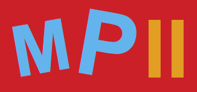

# Mille

**Mille** is the common I/O component of the [Millepede-II](https://gitlab.desy.de/millepede/millepede-ii) and [GeneralBrokenLines](https://gitlab.desy.de/millepede/general-broken-lines/) packages. 

It is used to store the equations defining a linear(ised) least squares problem into binary files that can then be processed within Millepede-II.

## Availability 

The source code of Mille is provided by DESY under the terms of the [LGPLv2 license](http://www.gnu.org/licenses/old-licenses/lgpl-2.0-standalone.html).

Detailed documentation will be added soon. 

The package can be compiled on its own using CMake, or as part of the Millepede-II / GBL projects. 

Please see the [documentation](https://millepede.pages.desy.de/millepede-ii/installation_page.html) of the parent packages for compilation / installation instructions.  

The software can be freely used for research and education. We expect that all publications describing work using this software quote at least one reference (see [here](http://www.desy.de/~blobel/mptalks.html) or [references](references)).

**Disclaimer**: This software is provided without any expressed or implied warranty. In particular there is no warranty of any kind concerning the fitness of this software for any particular purpose.

## Contact

For information exchange the **Millepede** mailing list
anacentre-millepede2 < at > desy.de should be used.
You can subscribe under this [link](https://lists.desy.de/sympa/info/anacentre-millepede2)
